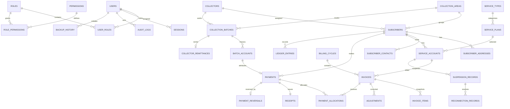

# BCIS Entity-Relationship Overview

The executable source of truth is `packages/database/src/schema.ts` plus the ordered SQL migrations. `DATA_MODEL.md` is the field-level data dictionary.

All money columns use integer centavos. Current balances, subscriber credit, receivables, aging, collection differences, and reports are derived from immutable source rows rather than maintained in editable summary tables.
